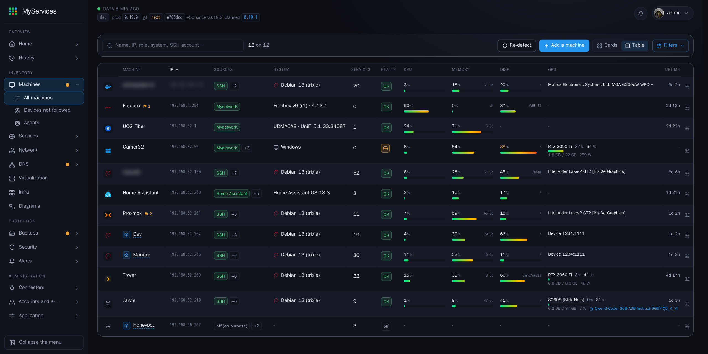
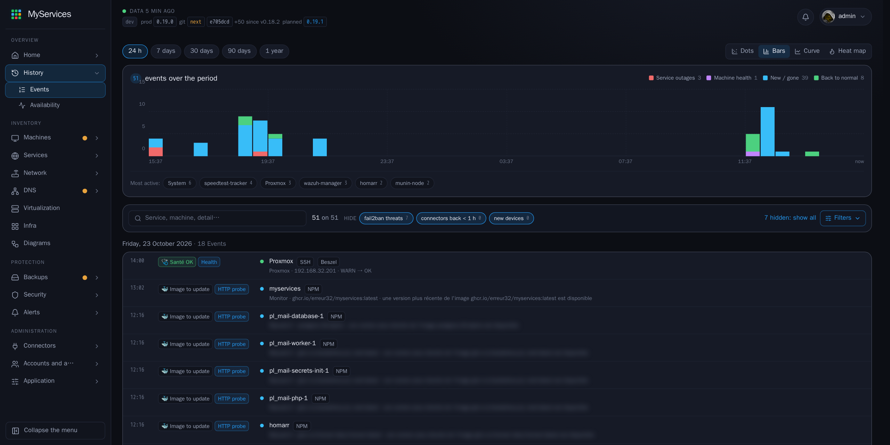

<p align="center"><a href="README.md">English</a> · <b>Français</b></p>

<p align="center">
  <picture>
    <source media="(prefers-color-scheme: dark)" srcset="docs/logo-dark.png">
    
  </picture>
</p>

<p align="center">
  <b>Tous les services et toutes les machines de votre réseau, sur une seule page, en lecture seule.</b><br>
  <sub>Il s'appuie sur les outils que vous utilisez déjà, sans les remplacer et sans jamais y écrire.<br>
  Là où aucun d'eux ne couvre une machine, MyServices la lit lui-même : par SSH, par son agent Windows ou par l'API de l'appli.</sub>
</p>

<p align="center">
  <a href="https://github.com/Erreur32/MyServices/releases/latest"></a>
  
  
  <a href="https://github.com/Erreur32/MyServices/pkgs/container/myservices"></a>
  
  <a href="https://github.com/Erreur32/MyServices/actions/workflows/docker-publish.yml"></a>
</p>

<p align="center">
  <br>
  <sub>Machines › Toutes les machines : toutes les machines du réseau d'un coup d'œil, quel que soit l'outil qui les lit (noms de domaine et adresse publique floutés).</sub>
</p>

<p align="center">
  <br>
  <sub>Accueil › Événements : ce qui est tombé, revenu, apparu ou disparu (noms de domaine et adresse publique floutés).</sub>
</p>

> ## Jeune, mais ça marche
>
> MyServices est un **jeune projet (`0.x`) qui fait déjà son travail** : il lit vos machines et vos services, montre leur état sur une seule
> page, garde un historique et lève des alertes. Il est maintenant ouvert à tous, et il **évolue encore vite** : les écrans, les réglages et
> les données enregistrées peuvent changer d'une version à l'autre.
>
> - **Ce qui est solide** : le cœur (collecte, santé, historique, alertes, comptes, API et MCP) et les connecteurs utilisés tous les jours sur
>   le réseau de l'auteur : **Nginx Proxy Manager, AdGuard Home, Beszel, Dockhand, Dozzle, Frigate, Glances, GpuViewR, Hermes Agent, Home
>   Assistant, LogviewR, MynetworK (et, par lui, UniFi et la Freebox), Uptime Kuma, Wazuh et Web-Check**.
> - **Ce qui est moins testé** : les autres connecteurs ont été écrits d'après la documentation de chaque service et essayés seulement contre
>   des serveurs simulés ; ils peuvent donc ne pas correspondre à toutes les versions ou installations. C'est pareil pour l'agent Windows
>   (un seul PC pour l'instant). Le [tableau des connecteurs](#connecteurs) plus bas dit lesquels sont lesquels. Si l'un ne correspond pas à
>   votre vrai service, dites-le-nous.
> - **Il ne fait que lire** vos machines : l'essayer présente peu de risque. Gardez une copie de `config/` et `data/` avant chaque mise à
>   jour, et laissez-le sur votre réseau local (jamais exposé directement sur Internet).
> - **Les retours sont les bienvenus** : [questions et idées](https://github.com/Erreur32/MyServices/discussions), bugs et demandes de
>   connecteur (voir plus bas). Les pull requests ne sont pas encore traitées.
>
> Chaque version est étiquetée et publiée comme image Docker. Les numéros restent **sous la 2.0.0** tant que le projet n'est pas déclaré stable (`0.31.5`, `0.31.6`…).
> Détail : [CHANGELOG.md](CHANGELOG.md) (en anglais) · [RELEASE-NOTES.md](RELEASE-NOTES.md) (en anglais).

## En bref

MyServices rassemble les services de toutes les machines de votre réseau local et en montre l'état en direct, **sur une seule page**. Il
interroge l'API des outils que vous utilisez déjà (ou la machine elle-même, par SSH ou par son agent Windows), recoupe leurs réponses et vous
signale ce qui demande votre attention.

- **Lecture seule** : rien n'est écrit sur ce qu'il observe.
- **Un seul conteneur** : collecte, veille, santé, sauvegardes, comptes, API et page web.
- Un **assistant de démarrage** : une décision à la fois, qui recommande la façon la plus simple de lire chaque machine.
- **Machines** lues par SSH (Linux), par un agent PowerShell (Windows), par l'API d'une appli, ou simplement par ping.
- **Environ 60 connecteurs** : Nginx Proxy Manager, AdGuard Home, Home Assistant, Proxmox, UniFi, MynetworK, Beszel, Ollama, Frigate… (lesquels sont éprouvés : voir [Connecteurs](#connecteurs)).
- **Cadres en direct avec historique** : joignabilité, santé, processeur et mémoire, services, sauvegardes, et le débit de votre accès Internet (Freebox et UniFi), sur 24 heures, 3 jours ou 7 jours.
- **Un historique** de chaque événement, avec ce qui l'a détecté et d'où vient l'information.
- **Schémas** générés pour vous (réseau, accès aux machines, sauvegardes, alertes, et d'autres en un clic).
- **Alertes et notifications** sur Discord, Telegram et webhook.
- Une **API REST** et un **serveur MCP** pour vos outils et assistants IA.

## Démarrage rapide (sur une machine de test)

```bash
mkdir -p /opt/myservices && cd /opt/myservices
curl -fsSLo docker-compose.yaml https://raw.githubusercontent.com/Erreur32/MyServices/main/deploy/compose.example.yaml
# facultatif : changer le port (8090 par défaut), voir la note plus bas
curl -fsSLo .env https://raw.githubusercontent.com/Erreur32/MyServices/main/deploy/env.example && nano .env      # modifier MYSERVICES_PORT
docker compose up -d
```

Puis ouvrez **`http://<IP>:8090/`** (l'appli est à la racine du site ; les anciennes adresses `/myservices/…` marchent toujours et redirigent) **dans les 30 minutes** pour créer le compte admin (passé ce délai :
`docker compose restart myservices`), et suivez l'**assistant de démarrage**, qui s'ouvre tout seul la première fois (six courtes étapes : cette machine, le réseau, la façon de lire chaque machine, vos outils, les alertes ; chaque étape se passe et se refait, depuis le menu du compte : « Revoir l'assistant de démarrage »), puis la page **Aide** du menu du compte. La clé SSH de l'app et la commande pour l'autoriser sur une machine sont dans **Machines › Connexions SSH**.

> **L'application écoute sur le port `8090`.** C'est un réglage, pas une valeur figée : si le 8090 est déjà pris sur votre machine, mettez **`MYSERVICES_PORT=8095`** (ou un autre port libre) dans un fichier `.env` à côté de `docker-compose.yaml` (exemple : [`deploy/env.example`](deploy/env.example), téléchargé par le second `curl` ci-dessus), puis lancez `docker compose up -d` et ouvrez `http://<IP>:8095/`. Le conteneur utilise le réseau de l'hôte : modifier un `ports:` ne servirait à rien.

Image : `ghcr.io/erreur32/myservices` (amd64 et arm64). `:latest` suit le dernier tag, `:0.31.5` une version précise, `:main` le dernier commit de la branche `main` (l'en-tête affiche alors par exemple `v0.10.1+ · main · abc1234`).
Mise à jour : `docker compose pull && docker compose up -d` (réglages et données restent dans les volumes `./config` et `./data`).

---

## Questions, idées, demandes de connecteur

- **Une question ou une idée** : [Discussions](https://github.com/Erreur32/MyServices/discussions).
- **Un bug** : ouvrir une issue avec le formulaire « Bug report » (le projet est en développement : vérifiez d'abord que vous avez la dernière image).
- **Un nouveau connecteur** (un service que MyServices devrait lire) : lire [Comment demander un connecteur](docs/CONNECTOR-REQUESTS.md)
  (en anglais), puis utiliser le formulaire d'issue « Connector request ».

Les pull requests ne sont pas encore traitées (voir l'avertissement en haut).

## En savoir plus

<details>
<summary><b>Ce que l'on voit : le menu</b></summary>

Un menu à gauche réunit toutes les pages, en quatre groupes ; les vues d'une page sont ses sous-pages, rangées dessous, chacune avec son adresse. Ce qui demande votre attention est le filtre « Alertes » de chaque liste (Sécurité : sa Vue d'ensemble). Une entrée apparaît dès que sa source est reliée.

| Groupe | Pages |
|---|---|
| **En bref** | **Accueil** (tableau de bord : ce qui demande votre attention, puis des compteurs qui ouvrent la page déjà filtrée ; puis l'historique : les événements de 24 h à un an, en points, barres, courbe ou carte de chaleur, et la disponibilité ; statistiques) |
| **Inventaire** | **Machines** (chaque machine, avec sa page et ses réglages ; appareils vus par vos outils mais pas suivis ; agents ; connexions SSH et clé SSH de l'app), **Services** (hôtes NPM et services locaux, chacun avec sa page, lue et modifiée sur place ; nouveaux services ; déclarer un service), **Réseau** (UniFi, Freebox, scan, équipements et appareils, diagnostic), **DNS** (AdGuard Home : serveurs, détails), **Virtualisation**, **IA et agents** (vue d'ensemble, modèles, agents et MCP, GPU ; visible dès qu'un service ou un connecteur IA existe), **Vidéo et caméras** (vue d'ensemble, caméras, flux, enregistrements ; visible dès qu'un service Stream ou un connecteur vidéo existe), **Schémas** |
| **Protection** | **Sécurité** (vue d'ensemble, sites exposés, accès SSH, ports du réseau, certificats, Fail2ban, Wazuh), **Sauvegardes** (par machine, jeux, ajouter des sauvegardes, à relier, copies ailleurs, emplacements cherchés) |
| **Collecte** | **Connecteurs** (les miens, disponibles, détectés à relier, déjà lus par SSH ou agent), **Découverte** (mode automatique, à faire, autres suggestions), **Tâches et horaires** |
| **Administration** | **Notifications** (canaux, règles d'alerte, mes notifications, exemples, derniers envois), **Comptes et accès** (comptes et sessions, jetons API et MCP), **Application** (mises à jour, e-mail, export et import, requêtes, journal d'audit, journaux, informations) |

Profil, Aide et À propos sont dans le menu du compte, en haut à droite.

Chaque filtre est un interrupteur : un clic le coupe, un autre le rallume ; plusieurs peuvent être actifs ensemble.

</details>

<details>
<summary><b>Comment les machines sont lues</b></summary>

Une machine peut être suivie de trois façons, qui se combinent. La première source qui répond fait foi, les suivantes complètent ce qu'elle n'a pas lu (l'ordre se règle machine par machine).

1. **MyServices lui-même**, rien d'autre à installer :
   - **SSH** (Linux) : MyServices se connecte avec **sa propre clé** (montrée dans Machines › Connexions SSH) et lit la santé, Docker, les services en écoute et les serveurs web. Vous l'autorisez sur chaque machine avec une commande. Un compte dédié non root, dans les groupes `docker` et `adm`, est le plus sûr.
   - **Agent** (Windows ou Linux) : un petit script en lecture seule (PowerShell en tâche planifiée, ou Python en minuteur systemd) envoie la santé de la machine, ses disques, ses ports, ses services, son matériel et ses conteneurs Docker. Rien à ouvrir côté PC.
2. **Services externes déjà installés sur le réseau** (connecteurs) : si vous faites déjà tourner Beszel, Proxmox, Uptime Kuma, MynetworK… MyServices lit leur API avec une clé en lecture seule. Rien n'est installé sur la machine.
3. **Ping et recherche réseau** : indiquent seulement si une machine est allumée et quelles applis y répondent. La première recherche sur le réseau local se lance toute seule, puis se répète à la fréquence choisie. En mode manuel, vous choisissez les machines à suivre ; en mode automatique, les plus utiles sont ajoutées pour vous.

> **Lequel choisir ? Une règle simple.**
> - **Un PC Windows ou une machine Linux** : l'agent. Il relit la machine chaque minute et l'envoie lui-même, sans clé SSH sur la machine.
> - **SSH** : gardé pour ce que l'agent ne lit pas (sauvegardes, Proxmox ou ESXi, NPM, AdGuard), pour un Mac (pas d'agent macOS), ou si l'agent ne peut pas être installé. Machines › Connexions SSH dit, machine par machine, si le SSH sert encore.
> - **Une box, une passerelle, une appli** (Freebox, UniFi, Home Assistant...) : le connecteur, pas d'agent.
>
> SSH, agent et connecteurs peuvent tourner ensemble sur une même machine. La santé vient de l'agent tant qu'il répond (le SSH prend le relais s'il se tait) ; un connecteur ajoute ce que lui seul connaît (machines virtuelles, clients réseau, GPU...), affiché en un badge par outil.

<details>
<summary><b>Agent ou services externes ? Ce que l'agent lit déjà</b></summary>

L'agent Windows est un seul petit script. Le tableau montre ce qu'il lit sur un PC et les outils externes qu'il faudrait pour obtenir la même chose. La colonne externe indique ce que ces outils couvrent en général pour cette liste, pas toutes leurs fonctions ; vérifiez leur documentation.

| Ce qui est lu | Agent MyServices (Windows) | Outils externes qui le remplaceraient |
|---|---|---|
| Charge CPU et mémoire | Oui | Beszel, windows_exporter (Prometheus), Netdata |
| Occupation des disques, par lecteur | Oui | Beszel, windows_exporter, Netdata |
| Santé des disques physiques | Oui | Beszel (SMART), windows_exporter |
| Durée de fonctionnement et dernier démarrage | Oui | Beszel, windows_exporter |
| Ports TCP en écoute et leur programme | Oui | Peu par défaut ; TCPView à la main |
| Services automatiques arrêtés en erreur | Oui | windows_exporter, agent Zabbix |
| Erreurs système graves (disque, NTFS, WHEA), 24 h | Oui | Graylog, Loki avec Alloy, Wazuh |
| Échecs de connexion (nombre, 24 h) | Oui (compte administrateur) | Wazuh, Graylog, transfert des journaux Windows |
| Mises à jour Windows en attente | Oui | WSUS, Intune, PDQ Deploy, Lansweeper |
| Redémarrage nécessaire | Oui | Gestionnaires de correctifs |
| Matériel : fabricant, modèle, BIOS, CPU, cœurs, RAM, GPU | Oui | GLPI avec FusionInventory, Lansweeper, Snipe-IT |
| Cartes réseau et adresse IPv4 | Oui (pas d'adresse MAC) | GLPI, Lansweeper ; MynetworK pour la MAC et le fabricant |
| Services en cours | Oui (jusqu'à 300) | windows_exporter, agent Zabbix |
| Conteneurs Docker du PC : nom, image, ports, état | Oui | Dockhand ou Portainer (API Docker exposée), Dozzle |
| Présence : allumé, en veille ou muet | Oui (l'agent se signale lui-même) | Uptime Kuma (ping ou port), MynetworK |
| Installation | Un script, une tâche planifiée, une seule connexion sortante vers MyServices | Un service par outil, son propre compte ou sa clé, un port à ouvrir sur le réseau |

Pour les machines Linux, l'agent Linux (Python 3.6+, systemd) donne les mêmes informations : choisir **Linux** à l'installation de l'agent (page de la machine, onglet **Accès**), puis coller la commande dans un terminal de la machine. Le SSH les donne aussi, sans rien installer, et reste nécessaire pour les sauvegardes, Proxmox ou ESXi, NPM et AdGuard.

</details>

<details>
<summary><b>Agent Windows : installation, sécurité, mises à jour</b></summary>

**Installation.** Ouvrez la page du PC (Machines › Toutes les machines, puis le PC), onglet **Accès**, puis « Installer l'agent Windows ». MyServices affiche une commande d'une ligne, avec le jeton, **une seule fois**. Collez-la dans un PowerShell **administrateur** sur le PC. L'installateur télécharge l'agent depuis MyServices, écrit ses réglages, crée la tâche planifiée *MyServices Agent* (exécutée en SYSTEM au démarrage, à l'ouverture de session et toutes les 15 minutes par défaut ; `-Minutes` change cela) et envoie un premier relevé. Seuls SYSTEM et les Administrateurs peuvent lire le dossier de l'agent (`C:\ProgramData\MyServices-Agent`), car le jeton s'y trouve. Pour le retirer : lancez l'installateur avec `-Uninstall`, puis révoquez le jeton dans ce même onglet **Accès**.

**Ce qu'il fait et ne fait pas.** L'agent lit seulement le PC et **envoie** son relevé à MyServices (rien n'est ouvert sur le PC). Il n'exécute aucune commande reçue du serveur, n'écoute sur aucun port et n'installe rien d'autre.

**Jeton et limites.**
- Un jeton par machine, montré une seule fois ; seule son empreinte SHA-256 est gardée. Un nouveau jeton pour la même machine révoque l'ancien. Le jeton n'ouvre qu'une route (envoyer son propre relevé) : il est refusé partout ailleurs, et les jetons d'API ou de MCP sont refusés sur cette route.
- Un relevé par minute et par agent (au-delà : `429`). Une IP qui présente 10 jetons inconnus en 15 minutes est refusée jusqu'à la fin de la fenêtre (les jetons révoqués ne comptent pas).
- Le nom du PC vu au premier relevé est retenu. Un relevé sous un autre nom (PC renommé, ou jeton copié sur un autre PC) est refusé tant que vous n'avez pas cliqué sur **Confirmer ce nom** sur la carte de l'agent ; l'événement est écrit au journal d'audit.
- Comme le reste de MyServices, la page et la route de l'agent ne répondent qu'aux réseaux autorisés par `MYSERVICES_ALLOW`. Le HTTP simple convient sur un réseau local de confiance ; derrière un proxy inverse, donnez à l'agent l'adresse HTTPS.

**Mises à jour.** La carte de l'agent affiche sa version. **Mettre à jour maintenant** ou l'interrupteur **Automatique** par agent (coupé par défaut) fait récupérer le nouveau script à MyServices au prochain relevé ; l'agent contrôle le SHA-256 et la syntaxe avant de se remplacer. Le script n'est pas signé : MyServices est la seule source de confiance.

**macOS.** Pas d'agent pour macOS : un Mac est lu par SSH.

</details>

Les machines trouvées mais pas suivies, les clés SSH à autoriser et les agents pas encore installés sont listés dans **Collecte › Découverte** et comptés dans la cloche de l'en-tête.

</details>

<details>
<a id="connecteurs"></a>
<summary><b>Connecteurs (environ 60)</b></summary>

Un connecteur laisse MyServices lire un outil par son API, **en lecture seule** : donnez-lui une clé ou un compte qui ne peut rien modifier. Collecte › Connecteurs › Mes connecteurs les liste, teste chacun (bouton **Tester**) et montre ce que la dernière collecte a lu. La sous-page **Détectés à relier** propose ceux qu'il a reconnus sur votre réseau, avec le formulaire déjà rempli ; **Déjà lus par SSH ou agent** liste les outils qu'une machine suivie donne déjà.

| Famille | Connecteurs |
|---|---|
| **Web et proxys** | **Nginx Proxy Manager**, **Web-Check** |
| **Applis** | **Home Assistant**, Netatmo, Tapo, Nextcloud, Jellyfin, Tautulli, Overseerr / Jellyseerr, Sonarr / Radarr / Prowlarr…, Bazarr, qBittorrent, Transmission |
| **DNS** | **AdGuard Home**, Pi-hole, Technitium DNS |
| **Supervision** | **Beszel**, **Uptime Kuma**, **Dozzle**, **Glances**, **LogviewR**, Prometheus, Healthchecks, Netdata, Pulse, Speedtest Tracker, Webmin, Umami, Rybbit |
| **Réseau** | **MynetworK** (UniFi et Freebox par lui), UniFi Network (direct), Tailscale / Headscale, OPNsense, NetAlertX, Box internet (UPnP IGD), FRITZ!Box, SFR Box, Livebox, Vodafone Station, Sagemcom F@st, Bbox, Swisscom Internet-Box, Compal Connect Box, Telekom Speedport, Technicolor Homeware, T-Mobile Home Internet, Hitron CODA, Verizon Fios, Arris SURFboard |
| **Sécurité** | **Wazuh**, CrowdSec |
| **Virtualisation et conteneurs** | **Dockhand**, Proxmox VE, Proxmox Datacenter Manager, VMware vCenter, Windows Admin Center, Portainer, Arcane, Unraid |
| **Stockage et sauvegardes** | Proxmox Backup Server, Veeam Backup & Replication, Veeam pour Microsoft 365, Backrest, borgmatic, UrBackup, TrueNAS, Synology DSM, dossier distant (FTP, FTPS, Samba) |
| **Énergie** | Onduleur (NUT) |
| **IA** | **Hermes Agent**, **GpuViewR**, Ollama, llama.cpp, Open WebUI, API compatible OpenAI (vLLM, LM Studio, LocalAI, KoboldCpp, LiteLLM) |
| **Vidéo et caméras** | **Frigate**, Shinobi, go2rtc, MediaMTX, Owncast |
| **Canaux** | Discord, Telegram, webhook |

> **En gras : utilisés tous les jours sur le réseau de l'auteur.** Les autres ont été écrits d'après la documentation de chaque service et
> **essayés seulement contre des serveurs simulés** : ils devraient marcher, mais n'ont pas encore rencontré une vraie installation (Proxmox,
> Veeam et Synology attendent un testeur). Si l'un ne correspond pas à votre vrai service, dites-le dans une issue.

Écrire un connecteur : [docs/CONNECTEURS.md](docs/CONNECTEURS.md). Idées d'autres connecteurs : [docs/IDEES-CONNECTEURS.md](docs/IDEES-CONNECTEURS.md).

</details>

<details>
<summary><b>Sauvegardes</b></summary>

Sauvegardes › Ajouter des sauvegardes montre les **sources** en tuiles (cliquez sur l'une : son assistant s'ouvre sous les tuiles) :

- **Dossiers sur mes machines** : trouvés par SSH aux endroits habituels (`/home/backup` est suivi automatiquement) ; vous cochez ceux à surveiller.
- **Veeam Backup & Replication** : API REST (port 9419) avec un compte en lecture seule (rôle *Veeam Backup Viewer*) ; vous choisissez les jobs à suivre.
- **Proxmox Backup Server** : groupes de sauvegarde (une VM, un conteneur ou un hôte par magasin) lus avec le jeton du connecteur existant (rôle *DatastoreAudit*).
- **Synology (Hyper Backup)** : les tâches Hyper Backup d'un NAS, lues avec le compte du connecteur Synology DSM existant (utilisateur en lecture seule) ; vous cochez les tâches à suivre, et chacune montre la date et le résultat de son dernier passage (un passage en échec, interrompu ou en retard déclenche une alerte ; une cible cloud ou distante compte comme copie hors machine). Routes écrites d'après l'API web de DSM, à confirmer sur un vrai NAS.
- **Home Assistant** : sa sauvegarde automatique, avec le jeton du connecteur existant. En option, avec le module communautaire **ha-mcp** installé dans Home Assistant (ce n'est *pas* le MCP natif de Home Assistant), collez son adresse dans le connecteur : MyServices lit alors aussi la liste réelle des sauvegardes (date, taille, chiffrée ou non, où chacune est copiée), les réparations, le contrôle de la configuration et les intégrations en erreur. Il ne lance que six lectures fixes et n'installe, ne supprime ni ne restaure rien ; activez aussi le mode lecture seule de ha-mcp.

- **Un dossier sur une box ou un NAS (FTP, FTPS, Samba)** : un compte saisi dans la page (mot de passe gardé chiffré) permet à MyServices de parcourir un dossier partagé et de le suivre, comme sauvegarde à part entière ou comme **copie de** une autre sauvegarde. Rien n'est écrit sur la box.
- **Un partage déjà monté sur la machine qui fait tourner MyServices** (Freebox, NAS) : le conteneur le lit en **lecture seule**, sans aucun compte stocké dans MyServices. Montez le partage sur l'hôte (par exemple `/mnt/nas`, avec `/etc/fstab` ou un automount systemd), puis ajoutez une ligne aux volumes de votre fichier compose :

  ```yaml
      volumes:
        - /mnt/nas:/mnt/nas:ro,rslave   # lecture seule ; rslave suit le montage / démontage d'un automount
  ```

  Recréez le conteneur (`docker compose up -d --force-recreate`), puis déclarez la box comme une machine avec `"mount": "/mnt/nas"` dans `backups-meta.json`. Le compte du partage n'a besoin que du droit de lecture. Préférez le montage quand le partage est déjà monté sur l'hôte ; préférez le compte quand il ne l'est pas.

Pour chaque sauvegarde suivie, vous fixez l'âge au-delà duquel une alerte part, et si une copie sur une autre machine est exigée. Les tâches cron et timers qui ressemblent à des sauvegardes sont listées à part.

</details>

<details>
<summary><b>Alertes et notifications</b></summary>

- **Canaux** : Discord, Telegram, webhook.
- **Alertes** : des règles choisissent quels événements (machine hors ligne, santé critique, sauvegarde en retard, nouveau service…) partent sur quel canal, avec un délai pour ne pas répéter la même alerte. Des préréglages aident à démarrer.
- **Notifications** : des messages que vous composez : un **rapport** de machines et de capteurs choisis à heure fixe, ou des **événements en direct** filtrés par type, machine ou texte. Des exemples prêts à l'emploi s'ajoutent en un clic, et « Envoyer maintenant » envoie un vrai message.

Les pannes sont confirmées sur plusieurs passages avant qu'une alerte parte.

</details>

<details>
<summary><b>Schémas</b></summary>

Générés avec [Archify](https://github.com/tt-a1i/archify) après chaque collecte : la **carte du réseau**, l'**accès aux machines** (chaque machine sous SSH, agent, connecteur ou aucun accès), les **sauvegardes** et la **chaîne d'alertes**.

La page **Schémas** en propose aussi que vous créez en un clic, construits avec ce que MyServices sait déjà : **équipements et appareils du réseau** (passerelle, switchs, bornes Wi-Fi et ce qui est branché sur chacun, lus par MynetworK et UniFi), **services par machine**, **domaines et leur chemin** (sous chaque NPM et chaque Apache) et **machines virtuelles et conteneurs** (Proxmox).

</details>

<details>
<summary><b>Sécurité et accès</b></summary>

- **Lecture seule par construction** : les connecteurs n'envoient que des requêtes GET (ou des commandes de lecture par SSH). Mots de passe et jetons sont stockés chiffrés (`enc:v1`) et jamais renvoyés à la page ; la clé SSH privée reste dans `config/ssh` (mode 600) et n'est jamais montrée.
- **Comptes** : comptes locaux (admin ou lecture seule), règles de mot de passe, liste des sessions, journal d'audit (filtrable, export CSV).
- **Réseau** : la page ne répond par défaut qu'aux réseaux privés et à la boucle locale (`MYSERVICES_ALLOW` pour changer). Ne l'exposez pas sur Internet ; passez par un VPN ou un proxy avec authentification pour un accès à distance (`MYSERVICES_COOKIE_SECURE=1` derrière HTTPS).
- **Le conteneur** : l'app tourne sous l'utilisateur `10001` (jamais root). Le conteneur démarre en root seulement le temps de donner `./config` et `./data` à ce compte, puis passe dessus sans plus aucune capacité noyau ; système de fichiers en lecture seule, `no-new-privileges`, pas de socket Docker (l'hôte est lu par SSH comme les autres).
- **Garde-fou avant commit et push** : `bash scripts/install-hooks.sh` refuse jetons, mots de passe, clés, `config.json`, `.env`, bases de données et images non relues.

</details>

<details>
<summary><b>Configuration</b></summary>

Presque tout se règle dans la page (Réglages). Fichiers et variables, pour mémoire :

| | |
|---|---|
| `./config` | `config.json`, `services-meta.json`, `secret.key`, `ssh/` (clé de l'app, alias, `known_hosts`) |
| `./data` | la page produite, caches, état, `myservices.db` (comptes, historique, alertes) |
| `MYSERVICES_PORT` | port de la page (défaut `8090`) |
| `MYSERVICES_ALLOW` | réseaux autorisés à ouvrir la page (défaut : réseaux privés et boucle locale) |
| `MYSERVICES_HOST_USER` | compte SSH de l'alias `hote` (la machine hôte) |
| `MYSERVICES_COLLECT_AT` | horaire de la collecte, `minutes heures` (défaut `0,15,30,45 *`) ; idem pour la veille et la santé |
| `TZ` | fuseau horaire |

Les horaires se modifient aussi à chaud dans Collecte › Tâches et horaires. Un exemple complet : [`deploy/compose.example.yaml`](deploy/compose.example.yaml).

</details>

<details>
<summary><b>API et MCP</b></summary>

Une API REST (`/api/v1/…`, documentation OpenAPI à `/api/v1/docs`) et un **serveur MCP** (`/mcp`, jeton `msv_mcp_`) laissent vos outils et assistants IA lire les mêmes données. Créez des jetons dans Administration › Comptes et accès › Jetons API et MCP, avec la durée de validité de votre choix : **read** (par défaut), **runs** (lecture + demander une collecte) ou **admin** (réglages compris ; une durée est obligatoire et votre mot de passe est demandé). Chaque outil MCP a son interrupteur.

</details>

<details>
<summary><b>Développer</b></summary>

```bash
docker build -t myservices:dev .
docker run --rm --entrypoint python -v $PWD:/src:ro -w /src myservices:dev -m unittest discover -s tests
cd front && npm ci && npm test && npm run dev      # :5180
```

Versions : `python3 scripts/release.py` vérifie que la version, les deux README, le journal des changements et les notes de version sont d'accord ; `release.py patch|minor|X.Y.Z` en applique une nouvelle partout (il ne commit, ne tague et ne pousse rien).
`.claude/` n'est jamais versionné.

</details>

> La documentation complète (installation détaillée, chaque connecteur, API et MCP) sera écrite à mesure que le projet mûrit ; la page **Aide** (menu du compte, en haut à droite) couvre aujourd'hui les premiers pas.
